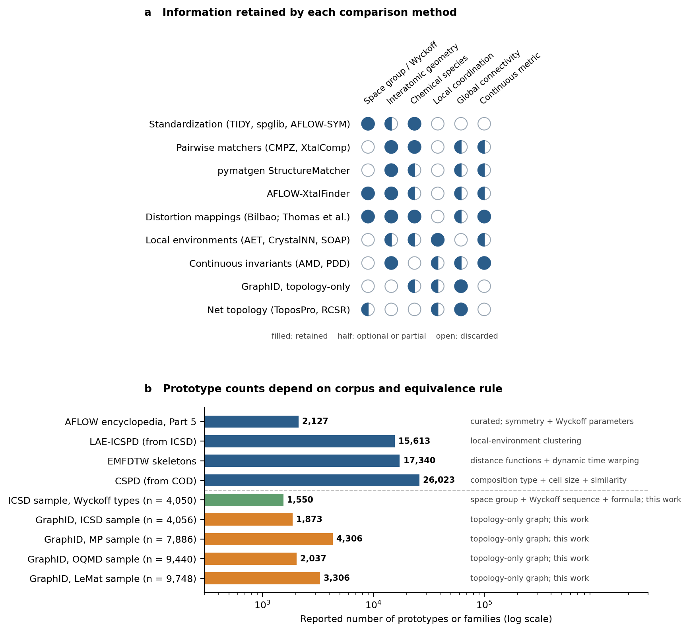

<p align="center"></p>

[](https://awesome.re)
[](LICENSE)
[](CONTRIBUTING.md)

> A curated list of resources on **crystal structural prototypes**: the libraries that catalog them, the algorithms that define and compare them, the databases they are drawn from, and the discovery and crystal structure prediction (CSP) methods that reuse them. It accompanies the survey *A Comprehensive Survey of Crystal Structural Prototypes: Construction, Classification, and Applications* (in preparation) and adds data from our own analysis of prototype families in four structure collections.

A prototype is only meaningful together with its equivalence rule (space group and Wyckoff positions, geometric matching, local environments, or periodic-graph topology), so entries state the rule wherever a library reports a count. Counts obtained under different rules are not comparable.

## About the Survey

**A Comprehensive Survey of Crystal Structural Prototypes: Construction, Classification, and Applications** (in preparation)

Jianjun Hu<sup>1,*</sup>, Ying Feng<sup>1</sup>, Rongzhi Dong<sup>1,3</sup>, Jeffrey Hu<sup>2</sup>, Remy Rogers<sup>1</sup>, Dipannoy Gupta<sup>1</sup>

<sup>1</sup> Department of Computer Science and Engineering, University of South Carolina, Columbia, SC 29201, USA<br>
<sup>2</sup> Department of Materials Science and Engineering, University of Illinois Urbana-Champaign, Urbana, IL, USA<br>
<sup>3</sup> Current affiliation: School of Artificial Intelligence, Wuhan University of Technology, Wuhan, China<br>
<sup>*</sup> Corresponding author: jianjunh@cse.sc.edu

The survey separates crystallographic types, geometric realizations, periodic topology and chemical decoration; compares curated and automatically extracted libraries; quantifies family statistics and definition sensitivity in four sampled collections; maps how prototypes enter substitution, screening, structure solution, CSP and generative design; and turns the limited-repertoire hypothesis into measurable quantities.

## Contents

- [About the Survey](#about-the-survey)
- [Prototype Libraries and Catalogs](#prototype-libraries-and-catalogs)
- [Defining and Comparing Prototypes](#defining-and-comparing-prototypes)
- [Source Databases](#source-databases)
- [Using Prototypes for Discovery](#using-prototypes-for-discovery)
- [Prototypes in CSP and Generative Models](#prototypes-in-csp-and-generative-models)
- [Mineral Families and Supergroups](#mineral-families-and-supergroups)
- [Is the Prototype Repertoire Limited?](#is-the-prototype-repertoire-limited)
- [Reviews](#reviews)
- [Data and Analysis from This Work](#data-and-analysis-from-this-work)
- [Contributing](#contributing)
- [Citation](#citation)
- [License](#license)

## Prototype Libraries and Catalogs

Curated and automatically extracted collections of crystal prototypes, with the equivalence rule each one uses. A machine-readable version of the main table is in [`data/prototype_libraries.csv`](data/prototype_libraries.csv).

### Open and computational libraries

* [AFLOW Prototype Encyclopedia](https://aflow.org/p/) - Curated prototypes defined by space group and Wyckoff positions with free parameters; 2,127 prototypes through Part 5, with a CIF and POSCAR for each. [[paper 2017](https://doi.org/10.1016/j.commatsci.2017.01.017)] [[paper 2019](https://doi.org/10.1016/j.commatsci.2018.10.043)] [[paper 2021](https://doi.org/10.1016/j.commatsci.2021.110450)] [[paper 2024](https://doi.org/10.1016/j.commatsci.2024.112988)] [[paper 2026](https://doi.org/10.1016/j.commatsci.2026.115022)]
* [AFLOW-XtalFinder](https://aflow.org/) - Identifies and groups prototypes by a symmetry prefilter followed by geometric misfit, with optional decoration and magnetic-configuration separation; groups AFLOW and ICSD structures automatically. [[paper](https://doi.org/10.1038/s41524-020-00483-4)]
* [CSPD (Crystal Structure Prototype Database)](https://doi.org/10.1088/1361-648X/aa63cd) - 26,023 prototypes built from COD by composition type, cell size and geometric similarity.
* [LAE-ICSPD](https://doi.org/10.1021/acs.jpca.2c03416) - 15,613 prototypes from ICSD by local-environment fingerprints and hierarchical clustering.
* [JAMIP](https://github.com/kzhoujlu/JAMIP-manual) - AI-aided infrastructure for computational materials science; integrates the ICSPD generation and analysis pipeline. [[paper](https://doi.org/10.1016/j.scib.2021.06.011)]
* [EMFDTW](https://doi.org/10.1021/acs.cgd.4c00346) - 17,340 skeleton prototypes from distance-matrix functions compared by dynamic time warping.
* [CAMD](https://doi.org/10.1039/D0SC01101K) - Symmetry- and Wyckoff-based candidate generation from prototypes inside an autonomous discovery loop.
* [Decoratypes](https://doi.org/10.1103/14yr-q3z1) - Extensible crystal taxonomy for machine-learning-guided materials discovery.

### Curated and proprietary references

* [ICSD structure types](https://icsd.products.fiz-karlsruhe.de/) - Structure types assigned by space group, Wyckoff sequence and stoichiometry (subscription). [[paper 2007](https://doi.org/10.1107/S0108767307038081)] [[paper 2019](https://doi.org/10.1107/S160057671900997X)]
* [TYPIX](https://doi.org/10.1007/978-3-662-02909-1) - Standardized data and crystal-chemical characterization of inorganic structure types (printed reference). [[paper](https://doi.org/10.6028/jres.101.022)]
* [Pauling File](https://paulingfile.com/) - Editor-assigned structure prototypes over inorganic structures, phase diagrams and properties (subscription). [[paper 1998](https://doi.org/10.1016/S0925-8388%2898%2900605-7)] [[paper 2004](https://doi.org/10.1016/j.jallcom.2003.08.058)] [[paper 2019](https://doi.org/10.1002/9783527802265.ch3)]
* [Pearson's Crystal Data](https://crystalimpact.com/pcd/) - Inorganic structural records with assigned structure types (licensed software). [[paper](https://arxiv.org/abs/2601.21393)]
* [A Brief History of Strukturbericht Symbols and Other Crystallographic Classification Schemes](https://doi.org/10.1088/1742-6596/1290/1/012016) (Mehl, 2019, Journal of Physics: Conference Series)
* [Concerning inorganic crystal structure types](https://doi.org/10.1107/S0108768198010969) (Bergerhoff et al., 1999, Acta Crystallographica Section B: Structural Science)
* [Nomenclature of inorganic structure types. Report of the International Union of Crystallography Commission on Crystallographic Nomenclature Subcommittee on the Nomenclature of Inorganic Structure Types](https://doi.org/10.1107/S0108767389008834) - IUCr nomenclature report defining isopointal and isoconfigurational structure types (Lima-de-Faria et al., 1990, Acta Crystallographica Section A: Foundations of Crystallography)

### Periodic nets and restricted domains

* [RCSR (Reticular Chemistry Structure Resource)](https://rcsr.net/) - Curated periodic nets, each with a symbol. [[paper](https://doi.org/10.1021/ar800124u)]
* [ToposPro](https://doi.org/10.1021/cg500498k) - Topological analysis of crystal structures via the underlying net after simplification.
* [Underlying nets in three-periodic coordination polymers: topology, taxonomy and prediction from a computer-aided analysis of the Cambridge Structural Database](https://doi.org/10.1039/c0ce00636j) (Alexandrov et al., 2011, CrystEngComm)
* [Three-dimensional Euclidean nets from two-dimensional hyperbolic tilings: kaleidoscopic examples](https://doi.org/10.1107/S0108767308040592) (Ramsden et al., 2009, Acta Crystallographica Section A: Foundations of Crystallography)
* [Computational Discovery of New Zeolite-Like Materials](https://doi.org/10.1021/jp906984z) (Deem et al., 2009, The Journal of Physical Chemistry C)
* [A database of new zeolite-like materials](https://doi.org/10.1039/C0CP02255A) (Pophale et al., 2011, Physical Chemistry Chemical Physics)
* [C2DB (Computational 2D Materials Database)](https://c2db.fysik.dtu.dk/) - Two-dimensional materials organized by prototype. [[paper 2018](https://doi.org/10.1088/2053-1583/aacfc1)] [[paper 2021](https://doi.org/10.1088/2053-1583/ac1059)]

## Defining and Comparing Prototypes

Standardization, equivalence rules and the algorithms that implement them.

### Standardization and structure comparison

* [The standardization of inorganic crystal-structure data](https://doi.org/10.1107/S0108767384000416) (Parthé et al., 1984, Acta Crystallographica Section A: Foundations of Crystallography)
* [Standardization of crystal structure data as an aid to the classification of crystal structure types](https://doi.org/10.1016/0925-8388%2893%2990049-S) (Parthé et al., 1993, Journal of Alloys and Compounds)
* [STRUCTURE TIDY---a computer program to standardize crystal structure data](https://doi.org/10.1107/S0021889887086965) (Gelato et al., 1987, Journal of Applied Crystallography)
* [A Procedure for the Clasification of Non-Organic Crystal Structures. I. Theoretical Background](https://doi.org/10.1107/S0108767396013852) (Burzlaff et al., 1997, Acta Crystallographica Section A: Foundations of Crystallography)
* [CMPZ---an algorithm for the efficient comparison of periodic structures](https://doi.org/10.1107/S0021889805032450) (Hundt et al., 2006, Journal of Applied Crystallography)
* [Identifying duplicate crystal structures: XtalComp, an open-source solution](https://doi.org/10.1016/j.cpc.2011.11.007) (Lonie et al., 2012, Computer Physics Communications)
* [Comparison of structures applying the tools available at the Bilbao Crystallographic Server](https://doi.org/10.1107/S1600576716002569) (Flor et al., 2016, Journal of Applied Crystallography)
* [Comparing crystal structures with symmetry and geometry](https://doi.org/10.1038/s41524-021-00627-0) (Thomas et al., 2021, npj Computational Materials)
* [pymatgen](https://github.com/materialsproject/pymatgen) - Python library with StructureMatcher for fitting structures under tolerance settings. [[paper](https://doi.org/10.1016/j.commatsci.2012.10.028)]
* [spglib](https://github.com/spglib/spglib) - Library for crystal symmetry search and space-group identification. [[paper](https://doi.org/10.1080/27660400.2024.2384822)]
* [AFLOW-SYM: platform for the complete, automatic and self-consistent symmetry analysis of crystals](https://doi.org/10.1107/s2053273318003066) (Hicks et al., 2018, Acta Crystallographica Section A: Foundations and Advances)

### Local environments, invariants and graphs

* [Atomic environments in relation to compound prediction](https://doi.org/10.1016/s0952-1976%2800%2900029-4) - atomic-environment types and compound prediction (Daams et al., 2000, Engineering Applications of Artificial Intelligence)
* [Data-driven atomic environment prediction for binaries using the Mendeleev number](https://doi.org/10.1016/j.jallcom.2003.08.060) (Villars et al., 2004, Journal of Alloys and Compounds)
* [Local structure order parameters and site fingerprints for quantification of coordination environment and crystal structure similarity](https://doi.org/10.1039/C9RA07755C) (Zimmermann et al., 2020, RSC Advances)
* [Benchmarking Coordination Number Prediction Algorithms on Inorganic Crystal Structures](https://doi.org/10.1021/acs.inorgchem.0c02996) (Pan et al., 2021, Inorganic Chemistry)
* [On representing chemical environments](https://doi.org/10.1103/physrevb.87.184115) - SOAP descriptors for chemical environments (Bartók et al., 2013, Physical Review B)
* [Average minimum distances of periodic point sets -- foundational invariants for mapping periodic crystals](https://doi.org/10.46793/match.87-3.529w) (Widdowson et al., 2022, MATCH Communications in Mathematical and in Computer Chemistry)
* [Pointwise Distance Distributions for detecting near-duplicates in large materials databases](https://arxiv.org/abs/2108.04798) (Widdowson et al., 2021)
* [Definition of a scoring parameter to identify low-dimensional materials components](https://doi.org/10.1103/physrevmaterials.3.034003) (Larsen et al., 2019, Physical Review Materials)
* [Universal graph-based identifiers of chemical structures for linking large material databases](https://doi.org/10.1038/s41467-026-74536-5) - GraphID, graph-based identifiers that link large materials databases; its topology-only option gives chemistry-anonymous families (Muraoka et al., 2026, Nature Communications)
* [Robocrystallographer: automated crystal structure text descriptions and analysis](https://doi.org/10.1557/mrc.2019.94) (Ganose et al., 2019, MRS Communications)
* [Atomic-position independent descriptor for machine learning of material properties](https://doi.org/10.1103/PhysRevB.98.214112) (Jain et al., 2018, Physical Review B)
* [Rapid discovery of stable materials by coordinate-free coarse graining](https://doi.org/10.1126/sciadv.abn4117) (Goodall et al., 2022, Science Advances)
* [Classification and statistical analysis of structural disorder in crystalline materials](https://doi.org/10.1107/S1600576725003000) (Antypov et al., 2025, Journal of Applied Crystallography)

## Source Databases

Structure collections from which prototypes are extracted.

* [ICSD](https://icsd.products.fiz-karlsruhe.de/) - Inorganic Crystal Structure Database of experimentally determined structures (subscription). [[paper](https://doi.org/10.1080/08893110410001664882)]
* [COD](https://www.crystallography.net/cod/) - Open-access Crystallography Open Database. [[paper 2009](https://doi.org/10.1107/s0021889809016690)] [[paper 2012](https://doi.org/10.1093/nar/gkr900)]
* [Materials Project](https://materialsproject.org/) - DFT-relaxed structures, largely drawn from the ICSD. [[paper](https://doi.org/10.1063/1.4812323)]
* [OQMD](https://oqmd.org/) - ICSD-derived structures plus hypothetical compounds generated by decorating common prototypes. [[paper 2013](https://doi.org/10.1007/s11837-013-0755-4)] [[paper 2015](https://doi.org/10.1038/npjcompumats.2015.10)]
* [AFLOW / AFLOWLIB](https://aflow.org/) - High-throughput framework and distributed properties repository. [[paper 2012](https://doi.org/10.1016/j.commatsci.2012.02.005)] [[paper 2012](https://doi.org/10.1016/j.commatsci.2012.02.002)]
* [Alexandria](https://alexandria.icams.rub.de/) - Large DFT database extending known prototypes by machine-learning-assisted element substitution. [[paper 2023](https://doi.org/10.1002/adma.202210788)] [[paper 2024](https://doi.org/10.1016/j.mtphys.2024.101560)]
* [GNoME](https://github.com/google-deepmind/materials_discovery) - Deep-learning-driven discovery of stable crystal structures at scale. [[paper 2023](https://doi.org/10.1038/s41586-023-06735-9)] [[paper 2024](https://doi.org/10.1021/acs.chemmater.4c00643)]
* [LeMat-Bulk](https://huggingface.co/datasets/LeMaterial/LeMat-Bulk) - Aggregate of Materials Project, OQMD and Alexandria records; not an independent database.
* [Materials Cloud](https://www.materialscloud.org/) - Open platform for computational science and data. [[paper](https://doi.org/10.1038/s41597-020-00637-5)]

## Using Prototypes for Discovery

How known arrangements become candidates, screens and solutions.

### Chemical substitution and screening

* [Data Mined Ionic Substitutions for the Discovery of New Compounds](https://doi.org/10.1021/ic102031h) - learned probabilities of ionic substitutions from known compounds (Hautier et al., 2011, Inorganic Chemistry)
* [Finding Nature’s Missing Ternary Oxide Compounds Using Machine Learning and Density Functional Theory](https://doi.org/10.1021/cm100795d) - substitution model plus DFT to predict missing ternary oxides (Hautier et al., 2010, Chemistry of Materials)
* [Computational Screening of All Stoichiometric Inorganic Materials](https://doi.org/10.1016/j.chempr.2016.09.010) (Davies et al., 2016, Chem)
* [Screening 39 billion protostructures for materials discovery](https://doi.org/10.48550/arXiv.2601.21393) (Parackal et al., 2026)
* [Active Learning Accelerated Discovery of Stable Iridium Oxide Polymorphs for the Oxygen Evolution Reaction](https://doi.org/10.1021/acs.chemmater.0c01894) (Flores et al., 2020, Chemistry of Materials)
* [High-throughput computation and structure prototype analysis for two-dimensional ferromagnetic materials](https://doi.org/10.1038/s41524-022-00813-8) - high-throughput prototype analysis of 2D ferromagnets (Shen et al., 2022, npj Computational Materials)
* [Digital features of chemical elements extracted from local geometries in crystal structures](https://doi.org/10.1039/d4dd00346b) (Vasylenko et al., 2025, Digital Discovery)

### Derivative structures and disorder

* [Algorithm for generating derivative structures](https://doi.org/10.1103/PhysRevB.77.224115) (Hart et al., 2008, Physical Review B)
* [Generating derivative structures from multilattices: Algorithm and application to hcp alloys](https://doi.org/10.1103/PhysRevB.80.014120) (Hart et al., 2009, Physical Review B)
* [Generating derivative structures at a fixed concentration](https://doi.org/10.1016/j.commatsci.2012.02.015) (Hart et al., 2012, Computational Materials Science)
* [High-entropy high-hardness metal carbides discovered by entropy descriptors](https://doi.org/10.1038/s41467-018-07160-7) (Sarker et al., 2018, Nature Communications)
* [Disordered enthalpy--entropy descriptor for high-entropy ceramics discovery](https://doi.org/10.1038/s41586-023-06786-y) (Divilov et al., 2024, Nature)

### Structure solution and framework design

* [High-throughput crystal structure solution using prototypes](https://doi.org/10.1103/physrevmaterials.5.105003) (Griesemer et al., 2021, Physical Review Materials)
* [Identifying crystal structures beyond known prototypes from x-ray powder diffraction spectra](https://doi.org/10.1103/physrevmaterials.8.103801) (Parackal et al., 2024, Physical Review Materials)
* [Topologically Guided, Automated Construction of Metal--Organic Frameworks and Their Evaluation for Energy-Related Applications](https://doi.org/10.1021/acs.cgd.7b00848) (Colón et al., 2017, Crystal Growth \& Design)
* [Inverse design of metal--organic frameworks for direct air capture of CO_2 via deep reinforcement learning](https://doi.org/10.1039/d4dd00010b) (Park et al., 2024, Digital Discovery)
* [Topology-based crystal structure generator](https://doi.org/10.1016/j.cpc.2018.09.016) (Bushlanov et al., 2019, Computer Physics Communications)

## Prototypes in CSP and Generative Models

Template-based prediction, hybrid pipelines, generators and baselines. Where code exists, the entry links to it and the paper.

### Template-based CSP and baselines

* [TCSP](https://github.com/usccolumbia/TCSP) - Template-based CSP that retrieves chemically compatible Materials Project templates and ranks them by chemical similarity and oxidation-state compatibility. [[paper](https://doi.org/10.1021/acs.inorgchem.1c03879)]
* [TCSP 2.0: Template based crystal structure prediction with improved oxidation state prediction and chemistry heuristics](https://doi.org/10.1016/j.commatsci.2025.114317) (Wei et al., 2026, Computational Materials Science)
* [Crystal structure prediction with machine learning-based element substitution](https://doi.org/10.1016/j.commatsci.2022.111496) (Kusaba et al., 2022, Computational Materials Science)
* [PNcsp+: A Periodic Number-Based Crystal Structure Prediction Method Enhanced by Machine Learning](https://doi.org/10.1021/acs.jctc.6c00044) (Oran et al., 2026, Journal of Chemical Theory and Computation)
* [Establishing baselines for generative discovery of inorganic crystals](https://doi.org/10.1039/d5mh00010f) - decorating AFLOW prototypes and data-driven ion exchange as baselines for generative discovery (Szymanski et al., 2025, Materials Horizons)
* [Substitution-Based Analysis of Structural Novelty for Generative Models of Materials](https://doi.org/10.48550/arxiv.2606.23166) (Negishi et al., 2026)

### Generators and coupled pipelines

* [CDVAE](https://github.com/txie-93/cdvae) - Crystal diffusion variational autoencoder for periodic materials. [[paper](https://arxiv.org/abs/2110.06197)]
* [DiffCSP](https://github.com/jiaor17/DiffCSP) - Joint equivariant diffusion for CSP. [[paper](https://arxiv.org/abs/2309.04475)]
* [DiffCSP++](https://github.com/jiaor17/DiffCSP-PP) - Space-group-constrained crystal generation. [[paper](https://arxiv.org/abs/2402.03992)]
* [FlowMM](https://github.com/facebookresearch/flowmm) - Riemannian flow matching for materials generation. [[paper](https://arxiv.org/abs/2406.04713)]
* [MatterGen](https://github.com/microsoft/mattergen) - Generative model for inorganic materials design. [[paper](https://doi.org/10.1038/s41586-025-08628-5)]
* [CrystaLLM](https://github.com/lantunes/CrystaLLM) - Autoregressive language-model generation of crystal structures. [[paper](https://doi.org/10.1038/s41467-024-54639-7)]
* [Equivariant Diffusion for Crystal Structure Prediction](https://arxiv.org/abs/2512.07289) (Lin et al., 2024, ICML (ICML))
* [Uni-3DAR](https://github.com/dptech-corp/Uni-3DAR) - Unified cross-scale 3D generation and understanding via autoregressive modeling. [[paper](https://arxiv.org/abs/2503.16278)]
* [Wyckoff Transformer: Generation of Symmetric Crystals](https://proceedings.mlr.press/v267/kazeev25a.html) (Kazeev et al., 2025, ICML)
* [WyCryst: Wyckoff Inorganic Crystal Generator Framework](https://doi.org/10.1016/j.matt.2024.05.042) (Zhu et al., 2024, Matter)
* [Efficient symmetry-aware materials generation via hierarchical generative flow networks](https://doi.org/10.1039/d4dd00392f) (Nguyen et al., 2026, Digital Discovery)
* [Symmetry-aware conditional generation of crystal structures using diffusion models](https://doi.org/10.1016/j.commatsci.2026.114789) (Ishii et al., 2026, Computational Materials Science)
* [Discovery of 2D Materials using Transformer Network‐Based Generative Design](https://doi.org/10.1002/aisy.202300141) (Dong et al., 2023, Advanced Intelligent Systems)
* [Data-driven discovery of 2D materials by deep generative models](https://doi.org/10.1038/s41524-022-00923-3) (Lyngby et al., 2022, npj Computational Materials)

### Benchmarks and evaluation

* [matbench-genmetrics](https://github.com/sparks-baird/matbench-genmetrics) - Python library for benchmarking crystal structure generative models. [[paper](https://doi.org/10.21105/joss.05618)]
* [Matbench Discovery](https://matbench-discovery.materialsproject.org/) - Framework for evaluating machine-learning crystal stability predictions. [[paper](https://doi.org/10.1038/s42256-025-01055-1)]
* [CSP Leaderboard](https://www.materialsatlas.org/csp-leaderboard/) - Benchmark of template, search-based and generative CSP methods on 180 targets (T180 v3.1) with a diagnostic cascade, institutions and links to code and checkpoints.
* [Deep Generative Crystal Structure Prediction: A Benchmark Study and a Controlled Test of Prototype Dependence](https://arxiv.org/abs/2609.26502) (Wei et al., 2026)

## Mineral Families and Supergroups

Names and classifications from mineralogy that complement computational catalogs.

* [Nomenclature of the garnet supergroup](https://doi.org/10.2138/am.2013.4201) (Grew et al., 2013, American Mineralogist)
* [Nomenclature of the perovskite supergroup: A hierarchical system of classification based on crystal structure and composition](https://doi.org/10.1180/minmag.2016.080.156) (Mitchell et al., 2017, Mineralogical Magazine)
* [Nomenclature and classification of the spinel supergroup](https://doi.org/10.1127/ejm/2019/0031-2788) (Bosi et al., 2019, European Journal of Mineralogy)
* [Structure of Spinel](https://doi.org/10.1111/j.1151-2916.1999.tb02241.x) (Sickafus et al., 1999, Journal of the American Ceramic Society)
* [The chemistry, structure and nomenclature of feldspars](https://doi.org/10.1515/9781501508547-006) (Ribbe, 1983, Feldspar Mineralogy)
* [The geometric blueprint of perovskites](https://doi.org/10.1073/pnas.1719179115) (Filip et al., 2018, Proceedings of the National Academy of Sciences)
* [Handbook of Mineralogy](https://handbookofmineralogy.org/pdf-search/) - Searchable descriptions of mineral species.

## Is the Prototype Repertoire Limited?

Statistics of structure-type reuse, and the protein-fold analogy.

### Crystal-chemical statistics

* [Frequency distribution and selection of space groups in inorganic crystal chemistry](https://doi.org/10.1007/s10947-009-0186-9) (Urusov et al., 2009, Journal of Structural Chemistry)
* [Some Statistics on Intermetallic Compounds](https://doi.org/10.1021/ic5024482) - heavy-tailed frequency distribution of intermetallic structure types (Dshemuchadse et al., 2015, Inorganic Chemistry)
* [Network analysis of synthesizable materials discovery](https://doi.org/10.1038/s41467-019-10030-5) (Aykol et al., 2019, Nature Communications)
* [The principles determining the structure of complex ionic crystals](https://doi.org/10.1021/ja01379a006) - Pauling's rules and the rule of parsimony (Pauling, 1929, Journal of the American Chemical Society)
* [Emergence of a few distinct structures from a single formal structure type during high-throughput screening for stable compounds: The case of RbCuS and RbCuSe](https://doi.org/10.1103/PhysRevB.92.165103) (Trimarchi et al., 2015, Physical Review B)
* [Challenges in High-Throughput Inorganic Materials Prediction and Autonomous Synthesis](https://doi.org/10.1103/prxenergy.3.011002) (Leeman et al., 2024, PRX Energy)

### Protein structure universe

* [One thousand families for the molecular biologist](https://doi.org/10.1038/357543a0) - early estimate of about one thousand protein families (Chothia, 1992, Nature)
* [Estimating the number of protein folds](https://doi.org/10.1006/jmbi.1998.2282) (Zhang et al., 1998, Journal of Molecular Biology)
* [Estimating the total number of protein folds](https://doi.org/10.1002/%28sici%291097-0134%2819990601%2935:4<408::aid-prot4>3.0.co;2-a) (Govindarajan et al., 1999, Proteins: Structure, Function, and Genetics)
* [The protein structure prediction problem could be solved using the current PDB library](https://doi.org/10.1073/pnas.0407152101) - PDB templates may already suffice for single-domain structure prediction (Zhang et al., 2005, Proceedings of the National Academy of Sciences)
* [On the origin and highly likely completeness of single-domain protein structures](https://doi.org/10.1073/pnas.0509379103) (Zhang et al., 2006, Proceedings of the National Academy of Sciences)
* [Further Evidence for the Likely Completeness of the Library of Solved Single Domain Protein Structures](https://doi.org/10.1021/jp211052j) (Skolnick et al., 2012, The Journal of Physical Chemistry B)
* [Global view of the protein universe](https://doi.org/10.1073/pnas.1403395111) (Nepomnyachiy et al., 2014, Proceedings of the National Academy of Sciences)
* [AlphaFold2 reveals commonalities and novelties in protein structure space for 21 model organisms](https://doi.org/10.1038/s42003-023-04488-9) (Bordin et al., 2023, Communications Biology)
* [Clustering predicted structures at the scale of the known protein universe](https://doi.org/10.1038/s41586-023-06510-w) (Barrio‐Hernandez et al., 2023, Nature)
* [Uncovering new families and folds in the natural protein universe](https://doi.org/10.1038/s41586-023-06622-3) (Durairaj et al., 2023, Nature)

## Reviews

Surveys that frame this area.

* [Structure prediction drives materials discovery](https://doi.org/10.1038/s41578-019-0101-8) - structure prediction as a driver of materials discovery (Oganov et al., 2019, Nature Reviews Materials)
* [Generative AI for crystal structures: a review](https://doi.org/10.1038/s41524-025-01881-2) (De Breuck et al., 2025, npj Computational Materials)
* [Artificial Intelligence Driving Materials Discovery? Perspective on the Article: Scaling Deep Learning for Materials Discovery](https://doi.org/10.1021/acs.chemmater.4c00643) (Cheetham et al., 2024, Chemistry of Materials)

## Data and Analysis from This Work

Chemistry-anonymous GraphID families (primary neighbor tolerance 0.10) in fixed-seed samples of four local structure collections. The OQMD cohort is the OQMD-derived part of the LeMat-Bulk CIF dump, so the OQMD and LeMat cohorts are not independent. Descriptive statistics only: not a database census or a saturation test.

| Collection | Files enumerated | Selected | Retained (ordered, 1-4 elements, at most 52 sites) | Families | Top-100 family coverage |
| --- | ---: | ---: | ---: | ---: | ---: |
| ICSD | 151,707 | 10,000 | 4,056 | 1,873 | 44.6% |
| Materials Project | 210,579 | 10,000 | 7,886 | 4,306 | 30.0% |
| OQMD (LeMat-Bulk entries) | 1,076,926 | 10,000 | 9,440 | 2,037 | 67.4% |
| LeMat-Bulk (PBE directory) | 3,126,657 | 10,000 | 9,748 | 3,306 | 52.9% |

- [`data/analysis/analysis_summary.json`](data/analysis/analysis_summary.json) - per-collection statistics, tolerance sensitivity and cross-cohort coverage.
- [`data/analysis/family_summary.csv`](data/analysis/family_summary.csv) - every observed family with its record count, number of distinct reduced formulas and representative formula.
- [`data/analysis/family_jaccard.csv`](data/analysis/family_jaccard.csv), [`directional_coverage.csv`](data/analysis/directional_coverage.csv), [`family_intersection_counts.csv`](data/analysis/family_intersection_counts.csv) - family-set overlap between collections.
- [`data/analysis/rarefaction.csv`](data/analysis/rarefaction.csv) - expected number of families versus sample size.
- [`data/prototype_libraries.csv`](data/prototype_libraries.csv) - the libraries above with year, equivalence rule, reported scope, download and licence.
- [`data/references.bib`](data/references.bib) - BibTeX for the cited papers.

<p align="center"></p>

## Contributing

Contributions are welcome. Read [CONTRIBUTING.md](CONTRIBUTING.md) for the entry format, then open a pull request or an issue.

## Citation

If this list is useful, please cite the accompanying survey once it is available:

```bibtex
@unpublished{Hu2026PrototypeSurvey,
  author = {Hu, Jianjun and Feng, Ying and Dong, Rongzhi and Hu, Jeffrey and Rogers, Remy and Gupta, Dipannoy},
  title  = {A Comprehensive Survey of Crystal Structural Prototypes: Construction, Classification, and Applications},
  note   = {In preparation},
  year   = {2026}
}
```

The entry will be updated with the venue and DOI after publication.

## License

[MIT](LICENSE). Linked resources keep their own licences; the access notes in the entries are summaries and not legal advice.
